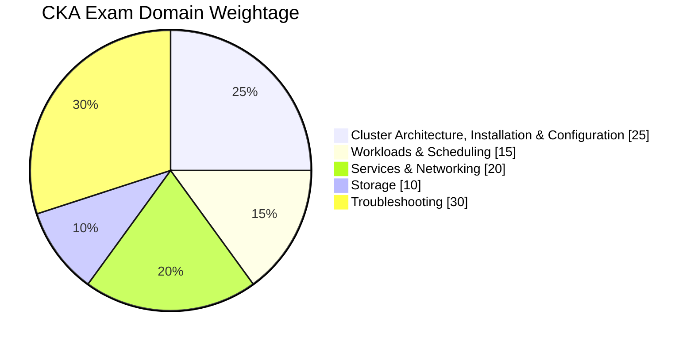
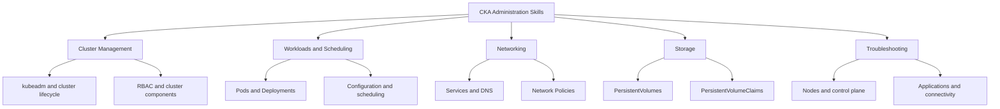
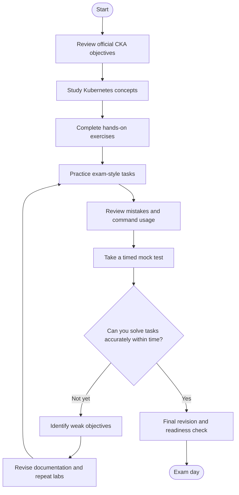
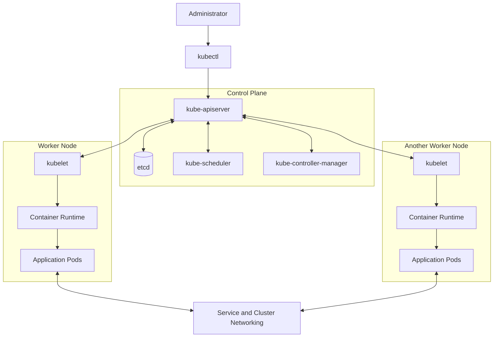
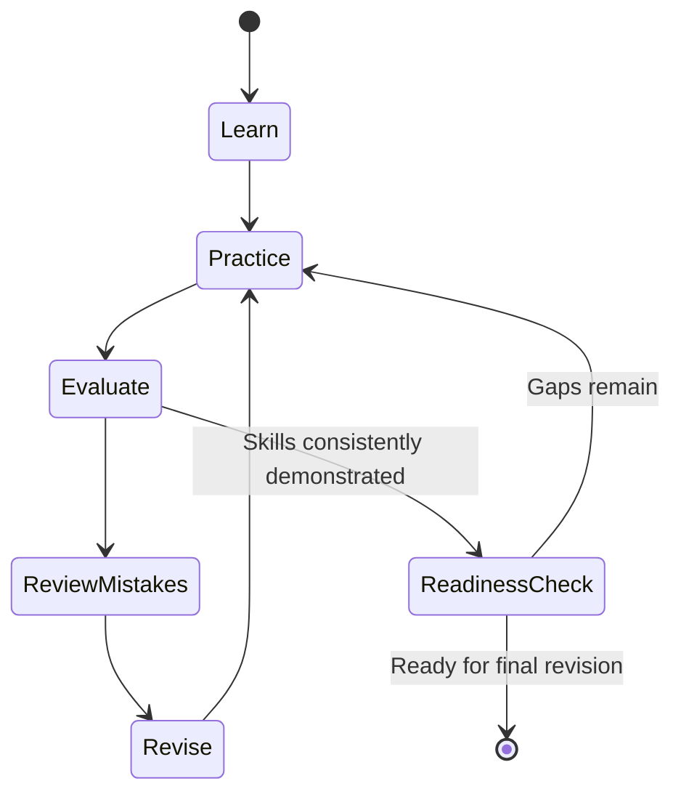
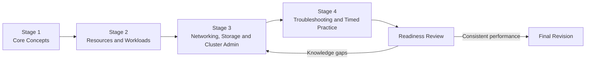
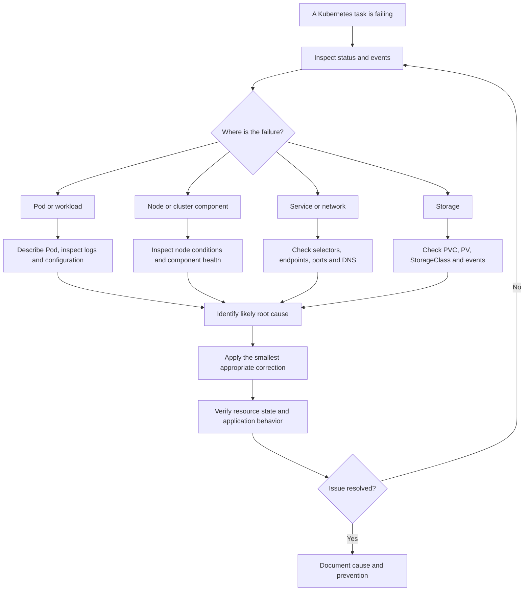

# Certified Kubernetes Administrator (CKA) Study Guide

A practical study guide for the **Certified Kubernetes Administrator (CKA)** certification from the Linux Foundation and the Cloud Native Computing Foundation (CNCF). This repository organizes Kubernetes administration concepts, official exam objectives, command-line exercises, troubleshooting scenarios, and a structured revision plan.

Whether you are building your first Kubernetes lab or strengthening your cluster administration skills, use this guide alongside the official documentation and regular hands-on practice.

**Exam preparation resource:** [CertsGate CKA Study Resources](https://certsgate.com/exams/linux-foundation/cka)

> **Important:** Exam details and Kubernetes versions can change. Always verify the current requirements on the [official CKA certification page](https://training.linuxfoundation.org/certification/certified-kubernetes-administrator-cka/).

---

## Table of Contents

- [About the CKA Certification](#about-the-cka-certification)
- [Who Should Prepare?](#who-should-prepare)
- [Exam Format and Domains](#exam-format-and-domains)
- [Official Exam Objectives](#official-exam-objectives)
- [CKA Preparation Flowchart](#cka-preparation-flowchart)
- [Kubernetes Architecture](#kubernetes-architecture)
- [CKA Study Cycle](#cka-study-cycle)
- [Step-by-Step Study Guide](#step-by-step-study-guide)
- [Suggested Study Roadmap](#suggested-study-roadmap)
- [Hands-On Kubernetes Labs](#hands-on-kubernetes-labs)
- [Practice Questions and Mock Tests](#practice-questions-and-mock-tests)
- [Troubleshooting Decision Tree](#troubleshooting-decision-tree)
- [Common Preparation Mistakes](#common-preparation-mistakes)
- [Career Relevance](#career-relevance)
- [Frequently Asked Questions](#frequently-asked-questions)
- [Official and Additional Resources](#official-and-additional-resources)
- [About CertsGate](#about-certsgate)

---

## About the CKA Certification

The **Certified Kubernetes Administrator (CKA)** is a practical, performance-based certification designed to assess the ability to administer Kubernetes clusters. It focuses on tasks such as cluster configuration, workload management, networking, storage, and troubleshooting.

Unlike an exam based entirely on multiple-choice questions, CKA requires candidates to solve tasks in a command-line environment. Understanding Kubernetes concepts is important, but you must also be able to apply them efficiently using `kubectl` and other relevant tools.

### Official exam information

| Item | Details |
|---|---|
| Certification | Certified Kubernetes Administrator (CKA) |
| Certification organizations | The Linux Foundation and CNCF |
| Exam type | Online, proctored, performance-based |
| Exam duration | 2 hours, according to the official certification page |
| Exam approach | Complete practical tasks in a Kubernetes command-line environment |
| Recommended preparation | Official objectives, Kubernetes documentation, hands-on labs, and timed practice |
| Official starting point | [CKA certification page](https://training.linuxfoundation.org/certification/certified-kubernetes-administrator-cka/) |

The official certification page currently identifies Kubernetes v1.35 as the exam software version. Check the live page before scheduling because the exam environment can be updated.

This guide is an independent learning aid, not a replacement for the current official curriculum or candidate instructions.

## Who Should Prepare?

CKA preparation is particularly relevant for:

- Kubernetes and platform administrators.
- DevOps and site reliability engineering professionals.
- Cloud administrators working with containerized applications.
- System administrators moving into cloud-native infrastructure.
- IT professionals who want practical Kubernetes cluster management skills.

A learner does not need to know every advanced Kubernetes feature before beginning. However, comfort with Linux commands, YAML, networking fundamentals, containers, and command-line tools makes preparation more manageable.

If Kubernetes is new to you, begin with Pods, Deployments, Services, Namespaces, and basic `kubectl` operations before attempting timed administration exercises.

---

## Exam Format and Domains

The published CKA curriculum identifies five weighted domains. The percentages below are taken from the CNCF curriculum and should be rechecked against the official exam page before your exam date.

| Domain | Published weight |
|---|---:|
| Cluster Architecture, Installation & Configuration | 25% |
| Workloads & Scheduling | 15% |
| Services & Networking | 20% |
| Storage | 10% |
| Troubleshooting | 30% |

### CKA domain weightage chart



Troubleshooting has the largest published weighting, so make sure your preparation includes diagnosing broken resources and services—not just creating working configurations.

### Conceptual skills map

This is a study overview, not a separate official scoring model.



Source: [CNCF CKA Curriculum](https://github.com/cncf/curriculum/blob/master/cka/README.md)

---

## Official Exam Objectives

Use the current official competency list as your preparation checklist. The following topics summarize the main areas represented in the published CKA curriculum.

### 1. Cluster Architecture, Installation & Configuration — 25%

Study:

- Kubernetes cluster components and their responsibilities.
- Cluster setup and lifecycle management with `kubeadm`.
- Role-based access control (RBAC).
- Control-plane and worker-node relationships.
- High-availability concepts.
- Kubernetes extension interfaces, including CNI, CSI, and CRI.
- Helm, Kustomize, custom resource definitions, and operators.

**Practice goal:** Explain the role of each major component and perform the relevant administration tasks in a lab.

### 2. Workloads & Scheduling — 15%

Study:

- Pods, ReplicaSets, and Deployments.
- Rolling updates and rollbacks.
- ConfigMaps and Secrets.
- Resource requests and limits.
- Node selectors, affinity, and taints and tolerations.
- Autoscaling concepts and workload reliability.

**Practice goal:** Create and modify workloads, control placement, and investigate Pods that fail to start.

### 3. Services & Networking — 20%

Study:

- Pod-to-Pod communication.
- ClusterIP, NodePort, and LoadBalancer Services.
- Service selectors and endpoints.
- CoreDNS.
- Ingress resources and controllers.
- Gateway API concepts included in the current objectives.
- Network Policies.

**Practice goal:** Trace a request from a client to a Service and then to the correct application Pod.

### 4. Storage — 10%

Study:

- PersistentVolumes (PVs).
- PersistentVolumeClaims (PVCs).
- StorageClasses and dynamic provisioning.
- Access modes and reclaim policies.
- Volume mounts and storage-related Pod failures.

**Practice goal:** Create a claim, attach it to a workload, verify that the volume is mounted, and diagnose a claim that remains Pending.

### 5. Troubleshooting — 30%

Study:

- Node and cluster-component failures.
- Application and Pod troubleshooting.
- Container output and logs.
- Resource usage and workload status.
- Service routing and networking problems.
- Events, conditions, and configuration errors.

**Practice goal:** Identify the cause of a failure before changing resources. Verify that the correction resolves the original problem.

For the complete competency list, consult the [official CKA certification page](https://training.linuxfoundation.org/certification/certified-kubernetes-administrator-cka/) and the [CNCF CKA curriculum](https://github.com/cncf/curriculum/blob/master/cka/README.md).

---

## CKA Preparation Flowchart

A repeatable study process helps prevent a common mistake: spending hours reading documentation without checking whether you can actually complete Kubernetes tasks.



Treat each mock test as a diagnostic tool. A low result is useful when it identifies a specific weakness that you can fix through targeted practice.

---

## Kubernetes Architecture

Understanding the relationship between the control plane, worker nodes, and workloads makes many administration and troubleshooting tasks easier.

The following diagram is a simplified learning illustration. Actual deployments vary by environment and configuration.



### Components to understand

| Component | Purpose |
|---|---|
| `kube-apiserver` | Exposes the Kubernetes API |
| `etcd` | Stores cluster state |
| `kube-scheduler` | Selects suitable nodes for unscheduled Pods |
| `kube-controller-manager` | Runs controllers that reconcile desired and actual state |
| `kubelet` | Manages Pods assigned to its node |
| Container runtime | Runs containers on a node |
| Service | Provides a stable way to access selected Pods |

Official reference: [Kubernetes Cluster Architecture](https://kubernetes.io/docs/concepts/architecture/)

---

## CKA Study Cycle

Reading about a resource is only the first step. Build it, inspect it, break it safely in a lab, diagnose the failure, and repeat the task until the commands and reasoning become familiar.



Use this cycle throughout your CKA preparation. Repetition is especially valuable for tasks that require several related commands under time pressure.

---

## Step-by-Step Study Guide

### Step 1: Build a Kubernetes foundation

Understand the purpose of clusters, nodes, Pods, controllers, Services, Namespaces, and the Kubernetes API.

Start with the official [Kubernetes Concepts documentation](https://kubernetes.io/docs/concepts/). Focus on understanding how resources relate to one another rather than memorizing definitions in isolation.

### Step 2: Become comfortable with `kubectl`

Practice commands for:

- Listing resources.
- Inspecting resource details.
- Reading events and logs.
- Creating and updating objects.
- Applying YAML manifests.
- Changing namespaces and contexts.
- Exporting or editing resource definitions when appropriate.

Examples:

```bash
kubectl get nodes
kubectl get pods -A
kubectl get deployments -A
kubectl describe pod <pod-name> -n <namespace>
kubectl logs <pod-name> -n <namespace>
kubectl get events -n <namespace> --sort-by=.metadata.creationTimestamp
kubectl config get-contexts
```

Replace placeholder names with resources in your own lab. Always check the active context and namespace before making changes.

### Step 3: Practice YAML and declarative configuration

Create manifests for Pods, Deployments, Services, ConfigMaps, Secrets, and storage resources.

Learn to recognize indentation errors, incorrect selectors, invalid field names, and mismatches between labels and Service selectors.

For example, inspect a Deployment's configuration and compare its labels with the selector used by the corresponding Service.

### Step 4: Practice cluster administration

Use a suitable lab to explore cluster status, node conditions, system components, and the cluster lifecycle. Study `kubeadm` workflows from the official documentation before attempting cluster initialization or upgrades.

Official guide: [Creating a cluster with kubeadm](https://kubernetes.io/docs/setup/production-environment/tools/kubeadm/create-cluster-kubeadm/)

Do not experiment with destructive cluster operations on a production environment.

### Step 5: Make troubleshooting a daily habit

Instead of always building healthy resources, introduce controlled errors in a disposable lab:

- Use an incorrect image name.
- Set a Service selector that does not match Pod labels.
- Configure an invalid container port.
- Request a nonexistent storage class.
- Apply a scheduling constraint that no node satisfies.

Diagnose each failure using resource status, events, logs, and configuration inspection. Then correct it and verify the result.

### Step 6: Practice under time constraints

Once individual tasks are familiar, combine them into timed sessions. Track the time required to understand the task, locate the relevant resource, implement the fix, and verify success.

The goal is not simply speed. It is accurate execution with a reliable verification step.

---

## Suggested Study Roadmap

This four-stage roadmap is an independent recommendation, not an official Linux Foundation schedule. Adjust the length to your experience and available study time.



| Stage | Focus | Practical outcome |
|---|---|---|
| 1. Foundation | Architecture, YAML, basic `kubectl` | Inspect and create basic resources |
| 2. Workloads | Pods, Deployments, scheduling, configuration | Deploy and modify applications |
| 3. Administration | Networking, storage, RBAC, cluster operations | Configure and verify cluster resources |
| 4. Performance | Troubleshooting, timed labs, mock tasks | Solve mixed tasks with fewer mistakes |
| Final review | Weak objectives and command recall | Confirm readiness without relying on memorization |

After each stage, record the tasks you can complete independently and the ones that still require documentation or repeated attempts.

---

## Hands-On Kubernetes Labs

Practical work should form a major part of a CKA study plan. These suggested exercises are independent practice activities, not official exam questions.

### Lab 1: Deploy an application

1. Create a Deployment with a small container image.
2. Scale the number of replicas.
3. Expose the Deployment with a Service.
4. Inspect the Pods and endpoints.
5. Perform a rolling update and test a rollback.

### Lab 2: Diagnose a failed Pod

1. Create a Pod with an intentionally incorrect image name.
2. Inspect the Pod's status and events.
3. Determine why the image cannot be pulled.
4. Correct the image reference.
5. Verify that the Pod reaches the Running state.

### Lab 3: Configure application settings

1. Create a ConfigMap.
2. Inject a setting into a Pod as an environment variable or mounted file.
3. Inspect the running workload's configuration.
4. Update the configuration and observe the effect.
5. Review the behavior of Secrets and handle sensitive values appropriately.

### Lab 4: Test Service connectivity

1. Deploy a simple application.
2. Create a Service with a matching selector.
3. Inspect the Service and its endpoints.
4. Test connectivity from another Pod.
5. Change a selector in the lab and diagnose the resulting connectivity issue.

### Lab 5: Work with persistent storage

1. Inspect available StorageClasses.
2. Create a PersistentVolumeClaim appropriate to your environment.
3. Mount the claim in a Pod.
4. Verify the mount and test writing a file.
5. Investigate a Pending claim and identify which storage requirement is not being met.

### Lab 6: Investigate a node problem

1. Inspect node readiness and conditions.
2. Review relevant events and system component status.
3. Check the affected workloads.
4. Form a hypothesis based on the available evidence.
5. Validate the root cause and document the recovery steps.

For every lab, write down the objective, commands used, expected result, actual result, root cause of any failure, and verification method.

---

## Practice Questions and Mock Tests

Practice questions can help you review concepts, but the CKA is a performance-based exam. Command-line exercises are essential.

Use practice materials to identify gaps, then recreate the underlying task in a lab.

A useful review process is:

1. Attempt a task without looking at the solution.
2. Check the result against the requirement.
3. Explain why your approach worked or failed.
4. Map the mistake to the relevant official objective.
5. Revisit the documentation or concept.
6. Repeat a similar task without copying the original solution.

### Example self-check questions

These are original learning prompts, not actual or official CKA exam questions.

**1. A Pod remains in `Pending`. What should you inspect first?**

Start by checking its status, events, and scheduling conditions. Possible causes include insufficient resources, scheduling constraints, or storage requirements that have not been satisfied.

```bash
kubectl describe pod <pod-name> -n <namespace>
kubectl get events -n <namespace> --sort-by=.metadata.creationTimestamp
kubectl get nodes
```

**2. A Service exists, but requests do not reach the application. What should you check?**

Inspect the Service selector, Pod labels, endpoints, target port, Pod readiness, and network configuration. Do not assume that the Service object itself proves that healthy backends are available.

**3. A PVC is stuck in `Pending`. Which resources should you inspect?**

Check the PVC details, related events, available PersistentVolumes, StorageClasses, access modes, capacity requirements, and dynamic provisioning configuration.

**4. A Deployment is not reaching its desired replica count. How do you investigate?**

Inspect the Deployment, ReplicaSet, Pods, events, scheduling status, and container logs. Determine whether the issue is related to image pulling, configuration, resource availability, or another failure.

**5. A node is `NotReady`. What is a sensible troubleshooting approach?**

Inspect node conditions and events, affected workloads, and relevant node and control-plane components. Use the evidence to narrow down the cause before applying changes.

### Using mock tests effectively

Use timed practice to measure task completion, accuracy, command familiarity, and the quality of your verification. If a mock test exposes repeated weaknesses, pause and practice those objectives before taking another full test.

The [CertsGate CKA preparation page](https://certsgate.com/exams/linux-foundation/cka) can serve as an additional third-party study resource alongside official documentation and hands-on work. Check the source and purpose of any practice material before relying on it.

---

## Troubleshooting Decision Tree

A repeatable troubleshooting process is more reliable than trying random commands.



### Useful troubleshooting commands

```bash
kubectl get pods -A
kubectl get nodes
kubectl get events -A
kubectl describe node <node-name>
kubectl describe deployment <deployment-name> -n <namespace>
kubectl describe service <service-name> -n <namespace>
kubectl get endpointslices -n <namespace>
kubectl get pvc -A
```

Some commands require a namespace, a resource name, or additional permissions. Check the relevant context before running commands that modify cluster resources.

---

## Common Preparation Mistakes

### Studying only theory

Kubernetes concepts matter, but knowing what a Deployment does is different from creating one, diagnosing a failed rollout, and verifying a rollback.

**Improve it:** Pair each topic with a command-line exercise.

### Memorizing commands without understanding output

A command can be familiar while the underlying failure remains unclear.

**Improve it:** Explain what each command reveals and what you would investigate next.

### Ignoring troubleshooting

Troubleshooting carries a substantial published exam weighting.

**Improve it:** Reserve regular practice time for broken workloads, node issues, networking, and storage.

### Skipping YAML practice

Small syntax and selector errors can prevent a configuration from working.

**Improve it:** Write manifests, apply them, inspect the resulting objects, and correct mistakes.

### Practicing without time limits

Untimed exercises are useful early, but they do not fully prepare you for a timed practical environment.

**Improve it:** Gradually introduce time limits after you understand the tasks.

### Trusting one practice source

A third-party resource may omit an objective or explain a feature differently from the current documentation.

**Improve it:** Use the official curriculum and documentation as your reference points.

### Forgetting to verify changes

A successful command does not necessarily mean the requested outcome has been achieved.

**Improve it:** Check resource status, events, endpoints, logs, and application behavior after making a change.

---

## Career Relevance

CKA preparation builds practical knowledge relevant to roles such as:

- Kubernetes administrator.
- Cloud or infrastructure engineer.
- DevOps engineer.
- Site reliability engineer.
- Platform engineer.

The most useful outcome is the ability to apply Kubernetes administration skills in realistic environments. A certification can help demonstrate those skills, but career outcomes also depend on practical experience, communication, and the requirements of individual employers.

---

## Frequently Asked Questions

### What is the CKA certification?

The Certified Kubernetes Administrator certification assesses practical skills in administering Kubernetes clusters. It is offered through the Linux Foundation and CNCF.

### Is the CKA exam practical?

Yes. The official exam is online, proctored, and performance-based. Candidates complete tasks in a Kubernetes command-line environment.

### How long is the CKA exam?

The official certification page currently lists a duration of two hours. Verify the current details before booking.

### Do I need hands-on Kubernetes experience?

There are no formal prerequisites listed on the current certification page, but hands-on practice is strongly recommended because the exam requires practical task completion.

### Which topic should I prioritize?

Use the current official objectives to plan your study time. The published curriculum assigns the largest weighting to Troubleshooting, followed by Cluster Architecture, Installation & Configuration. Do not neglect the remaining domains.

### Are practice questions enough to pass?

Practice questions alone are not a reliable substitute for command-line experience. Combine objective-based review, official documentation, hands-on labs, and timed practical exercises.

### How should I know when I am ready?

You should be able to solve representative tasks independently, explain the cause of common failures, work efficiently under time limits, and verify your changes. Mock-test performance is useful evidence, but no practice score guarantees a result.

### Where can I find official CKA objectives?

Start with the [Linux Foundation CKA page](https://training.linuxfoundation.org/certification/certified-kubernetes-administrator-cka/) and the [CNCF CKA curriculum](https://github.com/cncf/curriculum/blob/master/cka/README.md).

---

## Official and Additional Resources

Use official resources for exam requirements and authoritative technical explanations.

| Resource | Purpose |
|---|---|
| [Official CKA Certification Page](https://training.linuxfoundation.org/certification/certified-kubernetes-administrator-cka/) | Current exam details, objectives, and registration information |
| [CKA Program Changes](https://training.linuxfoundation.org/certified-kubernetes-administrator-cka-program-changes/) | Published competency updates |
| [CNCF CKA Curriculum](https://github.com/cncf/curriculum/blob/master/cka/README.md) | Domain weightings and competency overview |
| [Kubernetes Documentation](https://kubernetes.io/docs/home/) | Authoritative Kubernetes reference |
| [Kubernetes Concepts](https://kubernetes.io/docs/concepts/) | Architecture, workloads, networking, storage, and administration |
| [Cluster Architecture](https://kubernetes.io/docs/concepts/architecture/) | Control-plane and node components |
| [kubectl Reference](https://kubernetes.io/docs/reference/kubectl/) | Command syntax and usage |
| [kubeadm Documentation](https://kubernetes.io/docs/setup/production-environment/tools/kubeadm/) | Cluster setup and lifecycle tasks |
| [CertsGate CKA Resources](https://certsgate.com/exams/linux-foundation/cka) | Independent supplementary preparation material |

Always prioritize the current exam objectives over older notes or tutorials written for a different Kubernetes version.

---

## About CertsGate

[CertsGate](https://certsgate.com/) provides third-party IT certification preparation resources. Its [CKA preparation page](https://certsgate.com/exams/linux-foundation/cka) can be considered as a supplementary resource for study review and practice.

A balanced preparation plan should still be based on the official CKA curriculum, current Kubernetes documentation, and repeated hands-on exercises. Use third-party materials to reinforce understanding and identify areas for further study—not as a substitute for technical practice.

CertsGate is referenced here as an independent resource; this repository does not imply an official partnership or endorsement by the Linux Foundation or CNCF.

---
